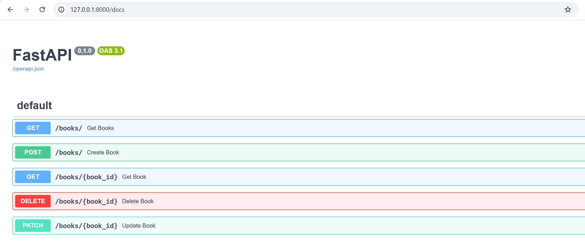
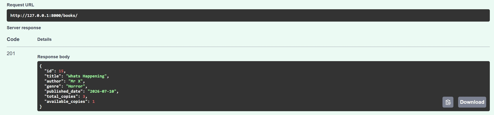
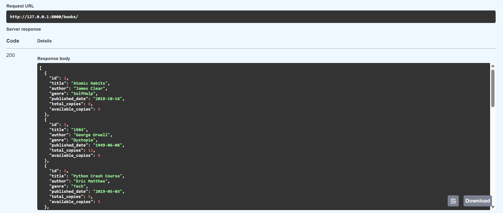
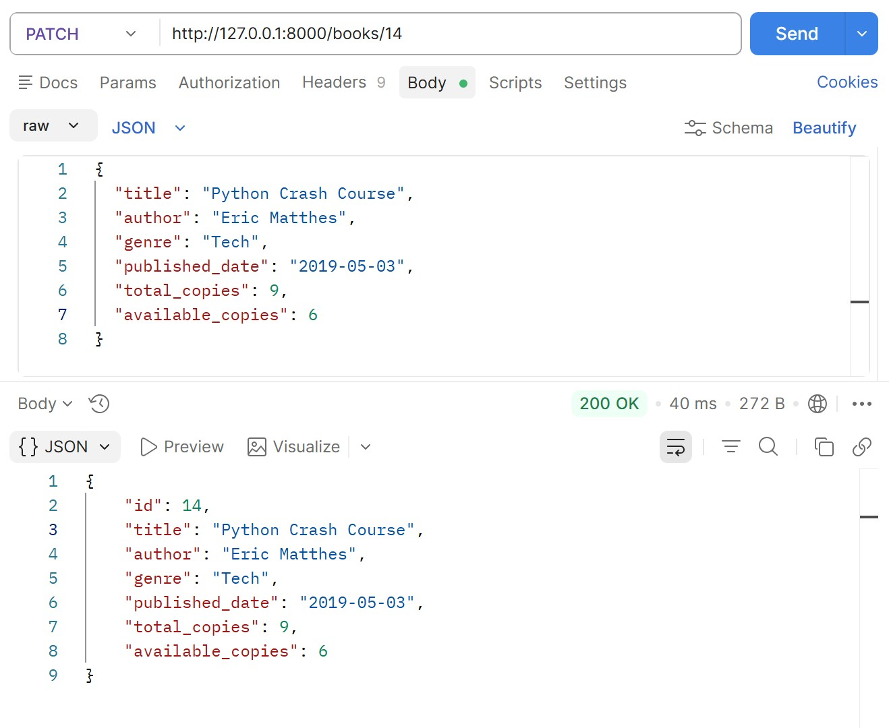
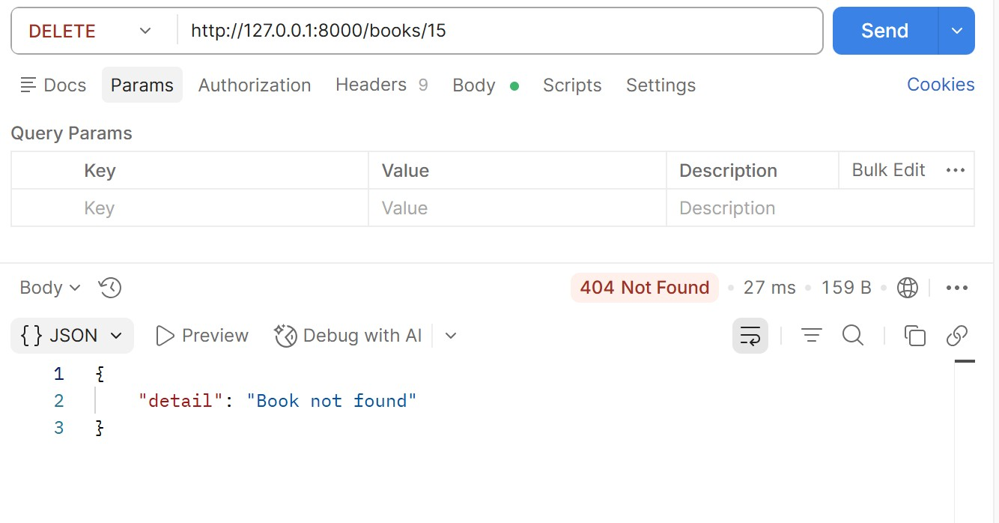

# Library Management API

A RESTful Library Management API built using **FastAPI**, **SQLAlchemy**, **MySQL**, and **Pydantic**. This project demonstrates CRUD (Create, Read, Update, Delete) operations with proper request validation, database integration, and REST API best practices.

---

## Features

- Create a new book
- Retrieve all books
- Retrieve a book by ID
- Update book details (partial updates using PATCH)
- Delete a book
- Input validation using Pydantic
- MySQL database integration with SQLAlchemy ORM
- Automatic interactive API documentation with Swagger UI
- API testing using Postman
- Environment variable support using `.env`

---

## Tech Stack

- **Backend:** FastAPI
- **Language:** Python 3.x
- **Database:** MySQL
- **ORM:** SQLAlchemy
- **Validation:** Pydantic
- **Server:** Uvicorn
- **Environment Variables:** python-dotenv
- **API Testing:** Swagger UI & Postman

---

## Project Structure

```text
Library-Management-API/
│
├── database.py          # Database configuration and session management
├── models.py            # SQLAlchemy database models
├── schemas.py           # Pydantic request/response schemas
├── main.py              # FastAPI application and API endpoints
├── requirements.txt     # Project dependencies
├── .gitignore
├── README.md
│
└── screenshots/
    ├── Homepage.jpg
    ├── Postman_Delete.jpg
    ├── Postman_Patch.jpg
    ├── Swagger_GetBooks.jpg
    └── Swagger_PostBooks.jpg
```

---

# API Endpoints

## Create a Book

**POST**

```
/books/
```

### Request Body

```json
{
  "title": "Clean Code",
  "author": "Robert C. Martin",
  "genre": "Programming",
  "published_date": "2008-08-01",
  "total_copies": 5,
  "available_copies": 5
}
```

### Response

```json
{
  "id": 1,
  "title": "Clean Code",
  "author": "Robert C. Martin",
  "genre": "Programming",
  "published_date": "2008-08-01",
  "total_copies": 5,
  "available_copies": 5
}
```

Status Code

```
201 Created
```

---

## Get All Books

**GET**

```
/books/
```

Returns a list of all books.

Status Code

```
200 OK
```

---

## Get Book by ID

**GET**

```
/books/{book_id}
```

Example

```
/books/1
```

Status Code

```
200 OK
```

If the book does not exist

```
404 Not Found
```

---

## Update Book

**PATCH**

```
/books/{book_id}
```

Example

```json
{
  "available_copies": 3
}
```

Only the provided fields will be updated.

Status Code

```
200 OK
```

---

## Delete Book

**DELETE**

```
/books/{book_id}
```

Example

```
/books/1
```

Status Code

```
200 OK
```

If the book is already deleted or does not exist

```
404 Not Found
```

---

# Validation Rules

The API validates incoming data using Pydantic.

Implemented validations include:

- All required fields must be provided while creating a book.
- `available_copies` cannot be greater than `total_copies`.
- PATCH requests allow updating only selected fields.
- Invalid requests return appropriate HTTP status codes.

Example validation error:

```text
Available copies cannot be greater than total copies
```

---

# 📷 Screenshots

### Swagger UI Homepage



---

### Swagger UI – Create Book API



---

### Swagger UI – Get All Books API



---

### Postman – Update Book API (PATCH)



---

### Postman – Delete Book API



# Testing

The API has been tested using:

- Swagger UI
- Postman

Tested operations include:

- Create Book
- Get All Books
- Get Book by ID
- Update Book
- Delete Book
- Validation Errors
- 404 Error Handling

---

# Dependencies

- FastAPI
- Uvicorn
- SQLAlchemy
- PyMySQL
- Pydantic
- python-dotenv

---

# Future Improvements

- User Authentication 
- Book Search
- Sorting & Filtering
- Borrow and Return Book APIs

---

# 👨‍💻 Author

**Sahil Khandare**

Engineering Student | AI, Machine Learning Enthusiast | Python Developer
